  
  
  

    

  

---

### 01 · About me

I'm **Đorđe**, a Software Engineering student at the **Faculty of Technical Sciences, University of Novi Sad** (**GPA: 9.5/10**). I enjoy building end-to-end applications, working through challenging algorithmic problems, and turning hackathon ideas into working prototypes.

- 💼 **Software Developer at PaySpot (Aug 2025 – Apr 2026):** worked across **Angular**, **C#/.NET**, **DB2/SQL**, and **JasperReports**, debugging and delivering web-application features with a team.
- 🥉 **3rd place — GDG DevFest 2026 Hackathon:** built **PitchCheck**, a privacy-first AI-powered pitch review platform with my team.
- 🧠 Interested in **full-stack engineering, applied AI, algorithms, and security-oriented systems**.
- 📍 Based in **Novi Sad, Serbia**.

### 02 · Selected projects

<table>
  <tr>
    <td width="50%" valign="top">
      <h3>🥉 <a href="https://github.com/tomovicj/pitchcheck">PitchCheck</a></h3>
      
A privacy-first AI pitch-review platform that analyzes presentation slides, spoken delivery, and how well a pitch matches its deck.

      
<b>3rd place · GDG DevFest 2026</b>

      
<code>Gemma 4</code> <code>Next.js</code> <code>FastAPI</code>

      <a href="https://github.com/tomovicj/pitchcheck">View team repository →</a>
    </td>
    <td width="50%" valign="top">
      <h3>🔐 <a href="https://github.com/id1119/master-recovery">Master Recovery</a></h3>
      
An experimental distributed secret-recovery protocol with threshold authorization, encrypted shares, a recovery delay, and local reconstruction.

      
<b>Petnica Web3 Hackathon 2026</b>

      
<code>Rust</code> <code>Cryptography</code> <code>Web3</code>

      <a href="https://github.com/id1119/master-recovery">Explore project →</a>
    </td>
  </tr>
  <tr>
    <td width="50%" valign="top">
      <h3>🔎 <a href="https://github.com/id1119/kp-market-scanner">KP Market Scanner</a></h3>
      
A Python scraper and ranking tool for KupujemProdajem listings. It filters irrelevant hardware offers, detects GPU models, and ranks results by relevance and deal signals.

      
<code>Python</code> <code>Requests</code> <code>Beautiful Soup</code>

      <a href="https://github.com/id1119/kp-market-scanner">Explore project →</a>
    </td>
    <td width="50%" valign="top">
      <h3>♟️ <a href="https://github.com/id1119/checkers-ai-engine">Checkers AI Engine</a></h3>
      
A custom strategy-game engine with minimax, alpha-beta pruning, iterative deepening, Zobrist hashing, and a transposition table.

      
<code>Python</code> <code>Game AI</code> <code>Search algorithms</code>

      <a href="https://github.com/id1119/checkers-ai-engine">Explore project →</a>
    </td>
  </tr>
</table>

Also built <b>Taskana</b>, an AI-agent freelance marketplace concept, with a team at the Petnica Web3 Hackathon (2026).

### 03 · Tech stack

**Languages**

**Frameworks & tools**

Also experienced with DB2, JasperReports, debugging, and collaborative Git workflows.

### 04 · Beyond the code

- 🎓 **BSc Software Engineering & Information Technologies** — University of Novi Sad, Faculty of Technical Sciences (2025 – present)
- 🏕️ **Web3 Camp** — Petnica Science Center (2026)
- 🛠️ **Industry + hackathons + university projects** — I like applying theory to real software.

---

  <b>Have a project in mind or want to talk software?</b> 
  <a href="mailto:djordje.zerajic0@gmail.com">Email me</a> · <a href="https://www.linkedin.com/in/%C4%91or%C4%91e-%C5%BEeraji%C4%87-56b387404/">LinkedIn</a> · <a href="https://github.com/id1119?tab=repositories">Explore my repositories</a>

